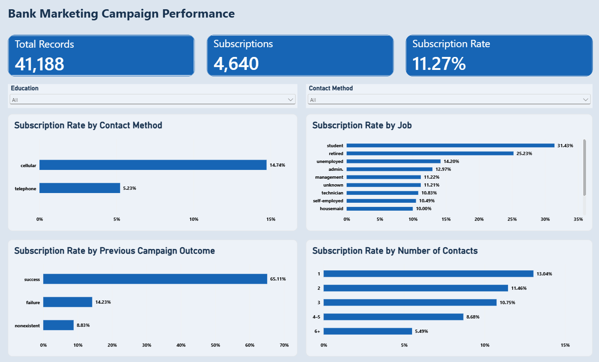

# Bank Marketing Campaign Analysis

**Python · Pandas · MySQL · SQL · Power BI · DAX**  
Personal data analytics project by Mariem Zoghlami

## Dashboard preview



[View the PDF report](PBI/Bank%20Marketing%20Campaign%20Analysis.pdf) · [Download the Power BI file](PBI/Bank%20Marketing%20Campaign%20Analysis.pbix)


## Project overview

This project analyzes historical telephone marketing campaign records from a Portuguese bank to understand how term deposit subscription rates vary across contact methods, customer characteristics, and campaign activity.

The workflow connects Python data preparation, SQL validation and analysis, and an interactive Power BI report. The result is a consistent set of metrics for exploring campaign outcomes and identifying questions for further investigation.

This is an independent portfolio project using public data, not a paid client engagement. The business questions below were developed for this analysis.

## Business questions

1. What is the overall term deposit subscription rate?
2. How do outcomes differ between cellular and telephone contact?
3. How do subscription rates vary by job category?
4. How do subscription rates vary by education level?
5. How do outcomes differ across the number of contacts made during the current campaign?
6. How does the recorded outcome of a previous campaign relate to current subscriptions?

## Key findings

| Metric | Result |
| --- | ---: |
| Campaign records | 41,188 |
| Subscriptions | 4,640 |
| Overall subscription rate | 11.27% |

Subscription rate is the number of records with a subscription divided by the total number of records in the selected group.

- **Contact method:** Cellular records had a 14.74% subscription rate, compared with 5.23% for telephone records. Cellular accounted for 3,853 subscriptions across 26,144 records; telephone accounted for 787 across 15,044 records.
- **Job category:** Students and retired people had the highest observed subscription rates, at 31.43% and 25.23%, respectively. Rates should be considered alongside group sizes and differences in customer characteristics.
- **Education:** University degree records had 1,670 subscriptions across 12,168 records, a rate of 13.72%. The illiterate category had a higher rate of 22.22%, but included only 18 records, making it unsuitable as a strong basis for targeting decisions.
- **Current campaign contacts:** Subscription rates were 13.04% for one contact, 11.46% for two, 10.75% for three, 8.68% for four to five, and 5.49% for six or more contacts.
- **Previous campaign outcome:** Records with a previous successful outcome had a 65.11% subscription rate, compared with 14.23% following failure and 8.83% where no previous outcome was recorded.

These are descriptive associations. They do not establish that a contact method, additional call, or customer characteristic caused an outcome.

## Business interpretation

The results suggest useful areas for further investigation: differences in channel selection, the performance of repeat contacts, and the relevance of previous campaign history. Before changing a campaign strategy, a business should examine group sizes, customer mix, contact costs, and more recent data. A controlled test would be needed to estimate the effect of a proposed change.

## Data source

- **Repository:** [UCI Machine Learning Repository — Bank Marketing](https://archive.ics.uci.edu/dataset/222/bank+marketing)
- **Original download:** `bank+marketing.zip`
- **Selected dataset:** `bank-additional-full.csv`, inside the nested `bank-additional.zip`
- **Size:** 41,188 records and 21 original fields
- **Period:** May 2008 to November 2010
- **Target:** `y` indicates whether a term deposit was subscribed to (`yes` or `no`).

Other versions included in the download were not combined with this dataset. Record counts are not presented as counts of unique customers because the source does not provide a unique customer identifier.

## Methodology

### 1. Python: preparation and quality checks

The preparation script reads the original CSV directly from the nested ZIP, checks the expected dimensions and target values, and creates a prepared dataset with 29 columns.

- Replaced dots in column names with underscores for easier SQL use.
- Added a sequential record ID for tracking rows in this project.
- Flagged 12 exact repeated rows. Retained them because there was insufficient evidence to determine whether they represented erroneous duplicates.
- Counted categorical `unknown` values without imputing unsupported replacements.
- Converted the target into a numeric `subscribed` field: yes = 1 and no = 0.
- Created a previous-contact indicator and converted the `pdays` sentinel value 999 into a missing value in a separate derived field.
- Added month numbers and current campaign contact bands: 1, 2, 3, 4–5, and 6+.
- Exported the prepared data, six grouped summaries, a data quality report, and headline metrics.

### 2. SQL: validation and business analysis

The prepared CSV was loaded into MySQL. Validation checked row counts, record ID uniqueness, target values, subscription totals, repeated-row flags, and consistency of the previous-contact fields.

SQL queries answered the six business questions using counts, sums, averages, and grouped results. Two views supported reporting:

- `campaign_reporting_view`: record-level fields used in Power BI.
- `contact_performance_view`: aggregated results by contact method.

The source is a single flat dataset. Additional tables and joins were not necessary for this analysis. The reporting view was exported as `campaign_reporting.csv` for Power BI.

### 3. Power BI: interactive reporting

The **Campaign Overview** report page includes:

- Three KPI cards: total records, subscriptions, and subscription rate.
- Four bar charts: subscription rate by contact method, job category, previous campaign outcome, and current campaign contact band.
- Education and contact method slicers.
- Record counts and subscriptions as tooltip fields to give context to rates.

The report imports a CSV export of the SQL view; it does not use a live MySQL connection. Filter checks confirmed the expected totals for cellular contacts and university degree records.

### DAX measures

```dax
Total Records = COUNTROWS(campaign_reporting)

Subscriptions = SUM(campaign_reporting[subscribed])

Subscription Rate =
DIVIDE([Subscriptions], [Total Records])
```

Subscription Rate is formatted as a percentage with two decimal places.

## Project files

| Location | Contents |
| --- | --- |
| `Python/bank_marketing_data_preparation.py` | Reproducible data preparation and summary exports |
| `Python/bank+marketing.zip` | Original UCI download used as script input |
| `Python/bank_marketing_outputs/` | Generated prepared dataset, summaries, and quality reports |
| `SQL/` | Database setup, table definition, import, validation, analysis, and view scripts |
| `campaign_reporting.csv` | SQL reporting view export used by Power BI |
| `PBI/Bank Marketing Campaign Analysis.pbix` | Interactive Power BI report |
| `README.md` | Project context, findings, methods, and reproduction instructions |

## How to run

### Python

1. Install Python and download the original ZIP from UCI.
2. Place `bank+marketing.zip` beside `bank_marketing_data_preparation.py` in the `Python` folder. Keep the ZIP compressed.
3. Install Pandas using the same Python environment used to run the script:

   ```bash
   python -m pip install pandas
   ```

4. Run the script from that folder, or use **Run Python File in Terminal** in VS Code:

   ```bash
   python bank_marketing_data_preparation.py
   ```

The script saves CSV files in `bank_marketing_outputs` beside itself and creates `bank_marketing_outputs.zip`. Rerunning overwrites generated files with the same names.

Expected results: **41,188 records, 4,640 subscriptions, a subscription rate of approximately 0.112654 (11.27%), and 12 repeated rows flagged.**

### MySQL

Run the saved SQL scripts in order: database setup, table creation, data import, validation, campaign analysis, and reporting views. Update the import path to the generated `bank_marketing_clean.csv` on your computer. The bulk import uses `LOAD DATA LOCAL INFILE`, which requires local-file import to be enabled for the client and server.

Do not rerun a destructive import against an existing table unless you intend to reload its data. Export all 41,188 rows from `campaign_reporting_view` as `campaign_reporting.csv`; remove the SQL client's default result limit before exporting.

### Power BI

Open the PBIX file in Power BI Desktop. To refresh on another computer, update its CSV source path to the local `campaign_reporting.csv` through **Data source settings**, then refresh. The existing saved report can be viewed without rebuilding the Python and SQL steps.

## Limitations and analytical decisions

- The data is historical and does not establish current marketing performance.
- The analysis measures subscriptions, not profitability or campaign return on investment; contact cost and revenue data were not available.
- Small groups can produce unstable rates. Counts should accompany percentage comparisons.
- More contacts may reflect difficulty converting a prospect; lower rates do not prove that additional calls reduce conversion.
- Month numbers support calendar ordering, but the month field alone cannot reconstruct a complete dated time series across years.
- Call duration is recorded after the call. It must not be used as a predictor in a model intended to select customers before a call. No predictive model was built in this project.
- The Python export represents missing derived previous-contact days as blank values. SQL import converts these to NULL. SQL CSV exports may represent NULL differently; normalize this field to numeric values and actual nulls before using it in further Power BI calculations. It is not used in the displayed report measures.
- The script is designed for this specific source file and checks its expected size; it is not a general-purpose ingestion system.

## Reference

## Data source

This project uses the public Bank Marketing dataset from the UCI Machine Learning Repository.

Source: https://archive.ics.uci.edu/dataset/222/bank+marketing

Dataset used: bank-additional-full.csv — 41,188 records.
